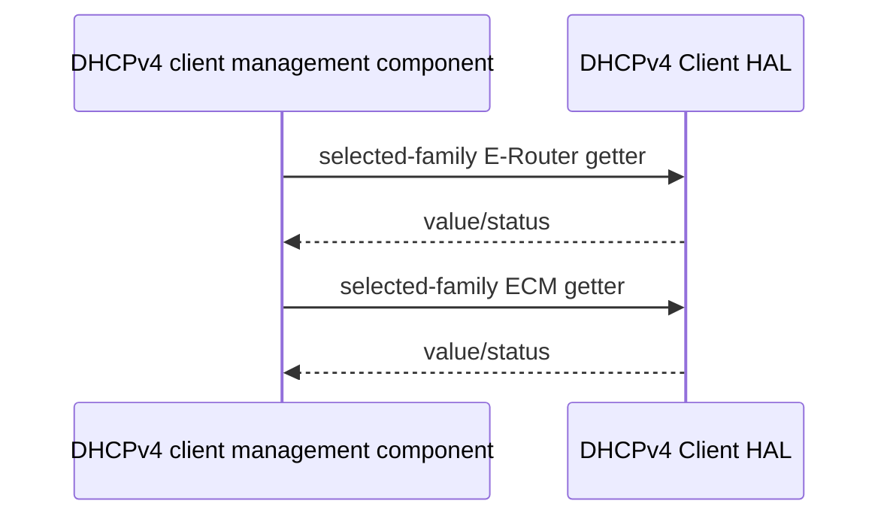

# DHCPv4 Client HAL Specification

## Version History

| Date | Comment | Version |
| --- | --- | --- |
| — | Documentation alignment; no ABI change. | — |

## Acronyms
HAL means Hardware Abstraction Layer; DHCP means Dynamic Host Configuration Protocol; ECM means Embedded Cable Modem; eMTA means embedded Multimedia Terminal Adapter.

## Description
The DHCPv4 client management component queries client state through the parallel `dhcp4c_` and `dhcpv4c_` API families.

## Optional Components
E-Router, ECM, and conditional eMTA support vary by product. Historical `UDHCPEnable_v2` selection describes integration guidance, not an implementation supplied here.

## Component Runtime Execution Requirements
### Initialization and Startup
The platform owns the underlying DHCP client lifecycle.
### Threading Model
Serialize access unless the implementation guarantees concurrency.
### Process Model
These are in-process getter calls, not an IPC or DHCP wire-protocol implementation.
### Memory Model
Callers own output pointers and arrays. Follow each declaration's exact storage size, address representation, and return convention; do not substitute conventions from another family.
### Asynchronous Notification Model
Poll snapshots at a product-appropriate rate.
### Internal Error Handling
Check each getter's return contract before using output. A getter may return a value or status according to its declaration.
### Persistence Model
The getters do not establish durable configuration or mutate the DHCP client.

## Nonfunctional Requirements
### Logging and Debugging
Implementations must not log credentials, secrets, security-sensitive information, or other sensitive data. Log operation outcomes rather than payloads.
### Quality Control
Use compiler warnings, static analysis, and memory checking. Test each enabled family and client role.
### Licensing
See repository Apache-2.0 notices.
### Build Requirements
Include the header matching the product API and link its implementation; legacy packaging names `libapi_dhcpv4c.so`.
### Variability Management
Honor conditional eMTA declarations and actual backend selection.

## Interface API Documentation
Each row explicitly identifies the parallel operations. The linked headers provide exact arguments, storage requirements, units, and returns.

| E-Router purpose | `dhcp4c` operation | `dhcpv4c` operation |
| --- | --- | --- |
| Lease | `dhcp4c_get_ert_lease_time` | `dhcpv4c_get_ert_lease_time` |
| Remaining lease | `dhcp4c_get_ert_remain_lease_time` | `dhcpv4c_get_ert_remain_lease_time` |
| Renewal | `dhcp4c_get_ert_remain_renew_time` | `dhcpv4c_get_ert_remain_renew_time` |
| Rebinding | `dhcp4c_get_ert_remain_rebind_time` | `dhcpv4c_get_ert_remain_rebind_time` |
| Attempts | `dhcp4c_get_ert_config_attempts` | `dhcpv4c_get_ert_config_attempts` |
| Interface | `dhcp4c_get_ert_ifname` | `dhcpv4c_get_ert_ifname` |
| State | `dhcp4c_get_ert_fsm_state` | `dhcpv4c_get_ert_fsm_state` |
| Address | `dhcp4c_get_ert_ip_addr` | `dhcpv4c_get_ert_ip_addr` |
| Mask | `dhcp4c_get_ert_mask` | `dhcpv4c_get_ert_mask` |
| Gateway | `dhcp4c_get_ert_gw` | `dhcpv4c_get_ert_gw` |
| DNS | `dhcp4c_get_ert_dns_svrs` | `dhcpv4c_get_ert_dns_svrs` |
| Server | `dhcp4c_get_ert_dhcp_svr` | `dhcpv4c_get_ert_dhcp_svr` |

| ECM purpose | `dhcp4c` operation | `dhcpv4c` operation |
| --- | --- | --- |
| Lease | `dhcp4c_get_ecm_lease_time` | `dhcpv4c_get_ecm_lease_time` |
| Remaining lease | `dhcp4c_get_ecm_remain_lease_time` | `dhcpv4c_get_ecm_remain_lease_time` |
| Renewal | `dhcp4c_get_ecm_remain_renew_time` | `dhcpv4c_get_ecm_remain_renew_time` |
| Rebinding | `dhcp4c_get_ecm_remain_rebind_time` | `dhcpv4c_get_ecm_remain_rebind_time` |
| Attempts | `dhcp4c_get_ecm_config_attempts` | `dhcpv4c_get_ecm_config_attempts` |
| Interface | `dhcp4c_get_ecm_ifname` | `dhcpv4c_get_ecm_ifname` |
| State | `dhcp4c_get_ecm_fsm_state` | `dhcpv4c_get_ecm_fsm_state` |
| Address | `dhcp4c_get_ecm_ip_addr` | `dhcpv4c_get_ecm_ip_addr` |
| Mask | `dhcp4c_get_ecm_mask` | `dhcpv4c_get_ecm_mask` |
| Gateway | `dhcp4c_get_ecm_gw` | `dhcpv4c_get_ecm_gw` |
| DNS | `dhcp4c_get_ecm_dns_svrs` | `dhcpv4c_get_ecm_dns_svrs` |
| Server | `dhcp4c_get_ecm_dhcp_svr` | `dhcpv4c_get_ecm_dhcp_svr` |

Conditional eMTA queries: `dhcp4c_get_emta_remain_lease_time`, `dhcp4c_get_emta_remain_renew_time`, `dhcp4c_get_emta_remain_rebind_time`, `dhcpv4c_get_emta_remain_lease_time`, `dhcpv4c_get_emta_remain_renew_time`, and `dhcpv4c_get_emta_remain_rebind_time`.

### Theory of Operation and Key Concepts
Independent getter calls need not form an atomic snapshot. Client states and address encoding must be interpreted using the selected header and implementation.

### Sequence Diagram

## Source References
- [dhcp4cApi.h](https://github.com/rdkcentral/rdkb-halif-dhcp/blob/develop/include/dhcp4cApi.h)
- [dhcpv4c_api.h](https://github.com/rdkcentral/rdkb-halif-dhcp/blob/develop/include/dhcpv4c_api.h)
